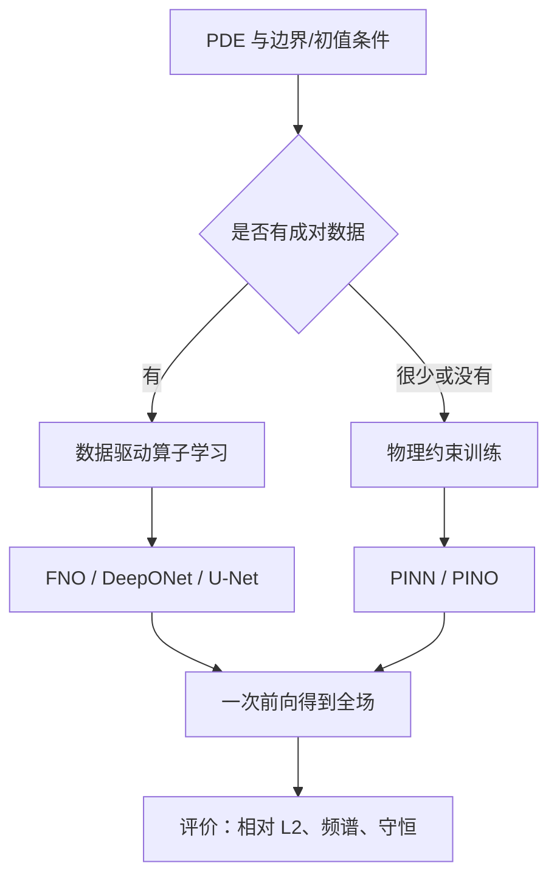

传统 CFD 的成本结构是“每个工况一次离散、一次迭代求解”。网格加密一倍，二维计算量约涨四倍，三维约涨八倍；而设计优化、参数反演、实时控制往往需要成百上千次求解。AI for CFD 的核心动机，是把“从输入场到解场”的映射本身学下来，用一次前向传播替代一次迭代求解。

先划清边界：本章的方法都建立在数值解或实验数据之上，它们不替代离散格式与湍流模型，而是与之互补——用数值解做标签，用 PDE 做约束。对[[ch2/governing-equations|控制方程]]与[[ch4/dns|直接数值模拟]]的清楚理解，仍然是读懂本章的前提。

## 两条技术路线

**路线一：物理约束。** 把 PDE 残差写进损失函数，用自动微分在配点上求导。代表是 PINN：输入为坐标 $(\mathbf{x},t)$，输出为该点的解，训练不需要标签，只需要方程、边界条件与初值条件。当输入从“坐标”换成“输入函数 $a(\mathbf{x})$”、输出换成整个解场时，就得到 PINO。

**路线二：数据驱动算子学习。** 从成对的（输入，解）数据中学习映射 $G$。FNO 用谱卷积在频域做全局卷积，DeepONet 用 branch/trunk 双网络分解，U-Net 用编码-解码结构做像素级的场映射。三者都可以在损失里追加物理项，因此两条路线并非对立。

## 统一记号

本章统一用 $a$ 表示输入函数（初始条件、边界条件、材料系数、几何参数等），$u$ 表示对应的解，$G$ 表示从输入函数到解函数的算子：

$$
G: a \mapsto u, \qquad u = G(a).
$$

“学习算子”就是构造带参数 $\theta$ 的网络 $\mathcal{N}_\theta$，使其在输入分布 $\mu$ 上逼近 $G$：

$$
\mathcal{N}_\theta \approx G \quad \text{for}\quad a \sim \mu .
$$

损失的一般形式是数据项与物理项的加权和：

$$
\mathcal{L}(\theta) = \lambda_d\,\mathcal{L}_{data}(\theta) + \lambda_p\,\mathcal{L}_{phys}(\theta),
$$

其中 $\lambda_d,\lambda_p$ 是平衡权重，$\mathcal{L}_{phys}$ 可以取 PDE 残差、边界条件偏差或守恒量误差。几乎所有模型页的差别，都可以归结为“$\mathcal{N}_\theta$ 长什么样”与“$\mathcal{L}_{phys}$ 怎么算”。

## 方法定位

| 方法 | 输入 → 输出 | 物理损失 | 擅长 | 局限 |
| --- | --- | --- | --- | --- |
| [[ch5/pinns|PINNs]] | 坐标 → 该点解 | 必需 | 逆问题、稀疏数据、任意几何 | 训练慢、多尺度与刚性方程困难 |
| [[ch5/fno|FNO]] | 网格上的场 → 网格上的场 | 通常不含，可追加 | 平滑周期场、分辨率泛化 | 非周期边界与陡间断表现差 |
| [[ch5/deeponet|DeepONet]] | 传感器值 + 查询点 → 查询点解 | 可追加 | 稀疏传感器、任意查询位置 | 传感器布置需固定，branch 容量受限 |
| [[ch5/unet|U-Net]] | 图像式场 → 图像式场 | 可选 | 稳态场回归、超分、亚格子闭合 | 分辨率绑定、需要较多数据 |
| [[ch5/ifno|IFNO]] | 场 → 场，隐式深度 | 可追加 | 大感受野、参数高效 | 不动点收敛与训练稳定性难调 |
| [[ch5/pino|PINO]] | 输入函数 → 解函数 | 数据 + 残差 | 多参数泛化且满足 PDE | 残差计算昂贵、权重敏感 |

## 一章的流程

## 建议的阅读顺序

1. 先读 [[ch5/pinns|PINNs]]：它把“残差损失 + 自动微分”讲透，是后面所有物理项的基础。
2. 再读 [[ch5/fno|FNO]]：理解谱卷积为什么能做成离散化不变的算子层。
3. 接着读 [[ch5/deeponet|DeepONet]]：对照 branch/trunk 分解，体会“输入函数”可以有不同的编码方式。
4. 工程上最常见的是 [[ch5/unet|U-Net]]：结构简单、训练稳定，适合作为第一个可跑通的基线。
5. 有深度需求时看 [[ch5/ifno|IFNO]]，要把物理项加进算子时看 [[ch5/pino|PINO]]。
6. 最后用 [[ch5/benchmarks|数据集与评价]] 校准实验设计，避免“指标好看但物理不可信”。

:::tip 先跑基线
新问题不要一上来就上 PINO。先用 U-Net 或 FNO 在中等分辨率上跑一个有监督基线，确认数据管线、归一化与评价指标无误，再逐步加入物理残差。多数失败来自数据与量纲，而不是网络结构。
:::

## 三个共同问题

无论哪条路线，都绕不开三件事：表示、约束与泛化。

**表示**决定网络能表达什么样的解。PINN 用 MLP 的隐式基函数；FNO 用截断的傅里叶模态；DeepONet 的基由 trunk 学出；U-Net 用局部卷积核叠加。基的选择直接决定对高频、间断与边界的表达能力：傅里叶基擅长平滑周期场，局部卷积核擅长边界与局部结构，MLP 则介于两者之间。

**约束**决定解是否可信。数据项只在观测点上起作用，物理项在配点上起作用，边界项在边界上起作用。三者缺一，网络就会在未约束的区域自由发挥：没有边界项，解在壁面附近漂移；没有物理项，网络可能拟合出违反守恒律的场。

**泛化**决定模型能否上线。分辨率变化考验离散化不变性，雷诺数变化考验参数外推，几何变化考验表示的灵活性。三者难度依次递增，报告结果时要分别说明。

一个反复出现的经验是：误差通常不出在“网络不够深”，而出在“约束没写对”。边界条件漏了一个面、归一化统计量用了测试集、残差项量纲不统一，都会让最先进的架构退化到不如双线性插值。

## 与数值方法的关系

AI 模型本身不产生新的离散格式，它的训练数据来自数值解或实验。因此更合理的定位是“代理”而非“替代”：用成熟求解器生成高质量数据，用网络做快速预测；预测结果再交给求解器做校正，或作为迭代初值加速收敛。混合方案在工程上通常比端到端替代更可靠，因为它保留了数值方法的守恒性与误差控制。

数据生成成本也值得提前估算：一次三维湍流高保真计算可能要数天，而成对样本往往需要成百上千组。这个成本经常超过训练网络本身，是选型时最容易被低估的一项。

另一个现实约束是训练时间：PINN 单次训练动辄数小时到数天，而一次二维 RANS 计算可能只要几分钟。因此 PINN 的优势不在“更快求解单个工况”，而在“没有网格、能融合稀疏观测、能做反演”。把两类成本放在同一张表里比较，才能做出合理选择。

还有一点常被忽略：网络推理是确定性的，但训练不是。同一份数据、同一套超参数，换个随机种子可能得到误差相差一个数量级的模型。工程部署前应至少跑三次，记录均值与方差，而不是挑最好的一次。

## 本章不涉及的内容

强化学习控制、扩散模型生成流场、以及把大语言模型用于 CFD 工作流，都不在本章范围内。它们与本章方法有交集，但评价体系与工程成熟度差异较大，留待后续补充。
